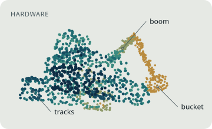
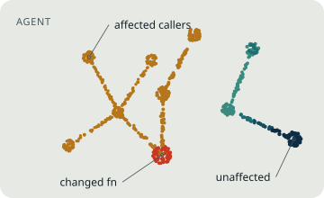
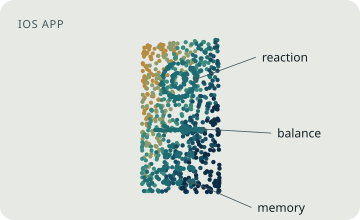
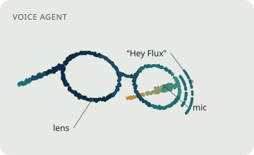
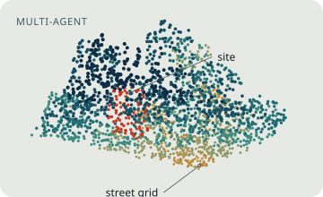
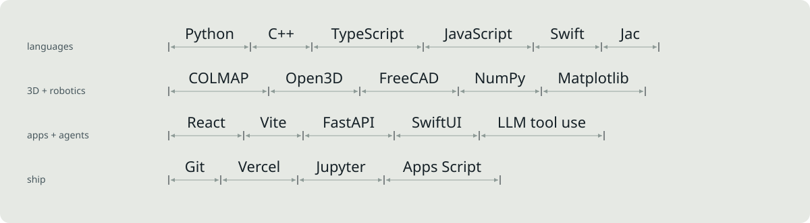

<a href="https://justin-kang.vercel.app"><picture><source media="(prefers-color-scheme: dark)" srcset="assets/scan-dark.svg"></picture></a>

I'm Justin, a UC Berkeley student who builds robots that see and AI agents that act. This fall I'm a robotics intern at **Ambi Robotics**. Most of what's below started at a hackathon.

**[Portfolio](https://justin-kang.vercel.app)** &nbsp;·&nbsp; **[justin-kang@berkeley.edu](mailto:justin-kang@berkeley.edu)**

## Capture: right now

- Robotics intern at **Ambi Robotics**, fall 2026
- Taking STAT 159 (Reproducible & Collaborative Data Science), IEOR 142A (Machine Learning & Data Analytics), ENGIN 183 (Technology Innovation & Entrepreneurship) and CW 11 (Public Speaking)
- Shipping small agentic tools between classes

## Reconstruct: things I've built

<table>
<tr>
<td width="300"><a href="https://github.com/KangJustin/rc-excavator-scanner"><picture><source media="(prefers-color-scheme: dark)" srcset="assets/rc-excavator-scanner-dark.svg"></picture></a></td>
<td><a href="https://github.com/KangJustin/rc-excavator-scanner"><b>RC Excavator Scanner</b></a> Act-a-thon · Actor Labs × Physical Intelligence  An RC excavator drives around an object and photographs it; the photos become a 3D mesh, measurements, and a parametric CAD model.  <code>COLMAP · Open3D · FreeCAD · Python</code></td>
</tr>
<tr>
<td width="300"><a href="https://github.com/KangJustin/blastradius"><picture><source media="(prefers-color-scheme: dark)" srcset="assets/blastradius-dark.svg"></picture></a></td>
<td><a href="https://github.com/KangJustin/blastradius"><b>BlastRadius</b></a> JacHacks 2026  Agentic code-risk analyst: walks a real call graph to show what breaks before you change a function, then explains the risk in plain English.  <code>Jac · LLM agents</code></td>
</tr>
<tr>
<td width="300"><a href="https://github.com/KangJustin/buzzbuddy"><picture><source media="(prefers-color-scheme: dark)" srcset="assets/buzzbuddy-dark.svg"></picture></a></td>
<td><a href="https://github.com/KangJustin/buzzbuddy"><b>BuzzBuddy</b></a> MLH × DigitalOcean SF Hackathon · 3rd place  iOS check-in companion that compares reaction time, balance and memory against your own sober baseline, with an agentic AI examiner.  <code>SwiftUI · FastAPI</code></td>
</tr>
<tr>
<td width="300"><a href="https://github.com/trigtbh/lahacks-26"><picture><source media="(prefers-color-scheme: dark)" srcset="assets/barelyatwork-dark.svg"></picture></a></td>
<td><a href="https://github.com/trigtbh/lahacks-26"><b>Barelyatwork</b></a> LA Hacks 2026  Voice assistant for Meta Ray-Ban glasses: say “Hey Flux” and speech becomes multi-step workflows across Gmail, Calendar, Slack and Notion.  <code>Voice · tool-using agents</code></td>
</tr>
<tr>
<td width="300"><a href="https://github.com/KangJustin/urbanpilot"><picture><source media="(prefers-color-scheme: dark)" srcset="assets/urbanpilot-dark.svg"></picture></a></td>
<td><a href="https://github.com/KangJustin/urbanpilot"><b>UrbanPilot</b></a> UC Berkeley AI Hackathon 2026  Multi-agent urban planning copilot: search a real address and get climate, accessibility and housing analysis with Current, 2040 and 2075 scenarios.  <code>JavaScript · Leaflet · multi-agent</code></td>
</tr>
</table>

Also: [IEOR 142A midterm review](https://github.com/KangJustin/ieor142a-midterm-review) (narrated video lessons + study guide) · [Deadline Digest](https://github.com/KangJustin/deadline-digest) (Apps Script that emails my course deadlines twice a week) · [Astrophysics visualizations](https://github.com/KangJustin/python-astrophysics-visualizations)

## Measure: tools I use

<picture><source media="(prefers-color-scheme: dark)" srcset="assets/measure-dark.svg"></picture>

---

Best way to reach me is email: [justin-kang@berkeley.edu](mailto:justin-kang@berkeley.edu). The point clouds on this page are illustrations drawn in the style of my excavator scanner's reconstructions.
